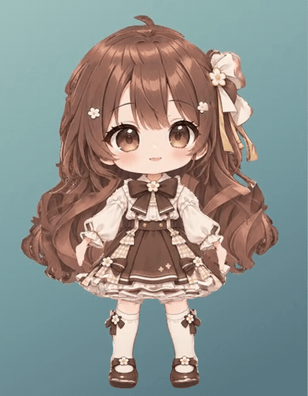

<div align="center">

# ChibiRigKit

**1枚のイラストから、配信で動くキャラクターを作るツール。**

<p>
  <a href="https://milkc0de.github.io/ChibiRigKit/">Web / Playground</a> ·
  <a href="docs/PLAYER.md">Player</a> ·
  <a href="docs/ADVANCED.md">Advanced</a>
</p>

<p>
  <a href="LICENSE"></a>
  
  
</p>

<a href="https://milkc0de.github.io/ChibiRigKit/#playground"></a>

<p>60秒の待機モーションからの抜粋 · <a href="https://milkc0de.github.io/ChibiRigKit/site/media/milkc0de-idle.mp4">全編を見る</a> · <a href="https://milkc0de.github.io/ChibiRigKit/#playground">プレイヤーで動かす</a></p>

</div>

## これは何？

1枚絵を動かすまでの面倒な部分を、なるべくまとめて自動化したくて作っています。

画像からリグ用のパーツや差分を作り、専用アプリまたはブラウザで顔・目・口・髪・体の動きを調整できます。カメラやマイクからの追従、モーションの録画・再生、WebM録画、OBSへのリアルタイム反映にも対応しています。

上の制作例では、正面の原画をもとに14方向のイラストを用意し、髪の揺れや手首の向きも調整した3Dモデルに仕上げました。同梱のmilkc0deで「3D待機」を選ぶと、ローカル版ではカメラの瞬きや視線、マイクの口パクが3Dモデルに反映されます。

最初は自分用の小さな実験でしたが、だいぶ普通に使えるところまで育ってきたので公開しています。まだbetaです。

### できること

- PNGなどの1枚絵からリグ作成を開始
- まばたき、視線、口パク、ヨー／ピッチ／ロール
- 髪や服の揺れ、長い髪の簡易物理
- カメラによる顔追従、マイクによる口パク
- 独自モーションの録画・保存・再生
- 背景画像、単色、透過
- WebM録画
- 完成したキャラクターをHTML + ZIPとして書き出し
- GPU対応のElectronアプリとして起動・書き出し（背面・最小化中も追従を継続）
- OBSブラウザソースへ同一PC内でリアルタイム反映
- 初回準備後のプレイヤー部分はオフライン動作

自動リグ作成にはCodexを使います。完成後の再生、調整、カメラ・マイク追従、OBS連携にCodexは不要です。

---

## Quick start

### 必要なもの

- Python 3.12+
- Node.js 22.12+
- Google Chrome / Chromium系ブラウザ
- Codex CLI（自動リグ作成を使う場合）

### 1. セットアップ

macOS:

```sh
sh SETUP.command
```

Linux:

```sh
sh SETUP.sh
```

Windows PowerShell:

```powershell
.\SETUP.ps1
```

### 2. 画像からキャラクターを作る

macOS:

```sh
sh AUTO_RIG.command "/Users/you/Pictures/character.png"
```

Linux:

```sh
sh AUTO_RIG.sh "/home/you/Pictures/character.png"
```

Windows:

```powershell
.\AUTO_RIG.ps1 "C:\Users\you\Pictures\character.png"
```

生成されたワークスペースは `characters/<name>/` に入ります。

途中から再開する場合:

```sh
sh AUTO_RIG.sh "./characters/<name>" --resume
```

細かいオプションや自動生成の流れは [docs/ADVANCED.md](docs/ADVANCED.md) にまとめています。

---

## Player

同梱のサンプルキャラクターを開く場合:

```sh
npm run player:setup   # 初回だけ
npm run desktop
```

別のキャラクター:

```sh
npm run desktop -- --character characters/<name>
```

専用ウィンドウでモーション、顔配置、背景、トラッキングなどを調整できます。GPUを利用できる環境では描画と顔追跡に使用します。追従中はOSの自動休止を抑え、停止時・終了時に解除します。カメラとマイクは「追従開始」を押してから使います。

配布用の専用アプリを作る場合:

```sh
npm run desktop:build -- --character characters/<name>
```

実行したOS・CPU用のアプリを `dist/desktop/` に保存します。完成したアプリの起動にNode.jsやPythonは不要です。ブラウザ版は従来どおり `npm run player` で起動できます。

既存キャラクターを再リグせず完成品へ書き出す場合:

```sh
npm run export -- --character characters/<name>
```

出力先:

```text
dist/<name>/
dist/<name>.zip
```

完成品HTMLにはキャラクター画像と設定を埋め込んでいます。

---

## OBS

完成品ZIPを展開し、OSに合わせて `START_SERVER` を起動します。

```text
Windows   START_SERVER.cmd / START_SERVER.ps1
macOS     START_SERVER.command
Linux     START_SERVER.sh
```

操作画面:

```text
http://127.0.0.1:5510/
```

OBSブラウザソース:

```text
http://127.0.0.1:5510/obs
```

映像そのものをOBSへ転送しているわけではなく、動きや設定値をローカルで共有し、OBS側でも同じキャラクターを描画しています。サーバーは `127.0.0.1` のみにbindします。

カメラ映像やマイク音声そのものをOBS連携用サーバーへ保存・転送する仕組みではありません。

詳しくは [docs/PLAYER.md](docs/PLAYER.md) をどうぞ。

---

## Project structure

```text
ChibiRigKit/
├── characters/          キャラクターごとのワークスペース
├── template/workspace/  新規キャラクター用テンプレート
├── studio/              ローカルプレイヤー / OBS連携
├── scripts/             セットアップ・生成・書き出し
├── tests/               テスト
└── docs/                詳細ドキュメント
```

リグの共通runtimeは `template/workspace/runtime/` にあります。

---

## Development

```sh
npm test
```

プレイヤーだけ触る場合は、作成済みキャラクターを指定して `npm run player` するのが早いです。

関連ドキュメント:

- [Player / カメラ・マイク・OBS](docs/PLAYER.md)
- [Advanced / JSON・検証・更新](docs/ADVANCED.md)
- [1枚画像からの差分生成](docs/SINGLE_IMAGE.md)
- [Head poses](docs/HEAD_POSES.md)
- [テスト定義](tests/test-cases.json)

---

## License

**ChibiRigKitのソースコードは Apache License 2.0 です。**

現在のライセンス全文は [LICENSE](LICENSE) にあります。以前MIT Licenseで公開したリリースや、その時点で取得されたコピーについては、そのMIT Licenseが引き続き適用されます。

キャラクター画像、イラスト、デモ画像・動画、ロゴなどのメディアはApache-2.0の対象ではありません。リポジトリに含まれるmilkc0de制作のメディアについては [MEDIA_NOTICE.md](MEDIA_NOTICE.md) を参照してください。ユーザーが持ち込んだ素材の権利は、それぞれの権利者に帰属します。

MediaPipe Tasks Vision、WASM、Face Landmarkerモデルなどの第三者コンポーネントには、それぞれのライセンスとnoticeがあります。完成品ZIPにも必要なライセンス表記を同梱します。

---

<div align="center">
  <sub>made by <a href="https://github.com/milkc0de">milkc0de</a></sub>
</div>
